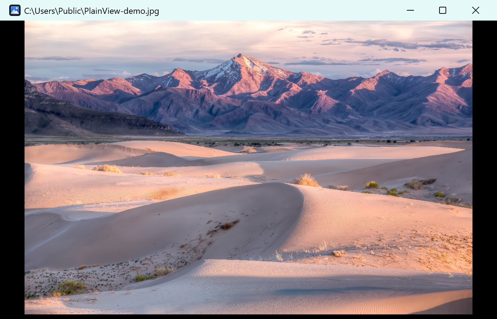
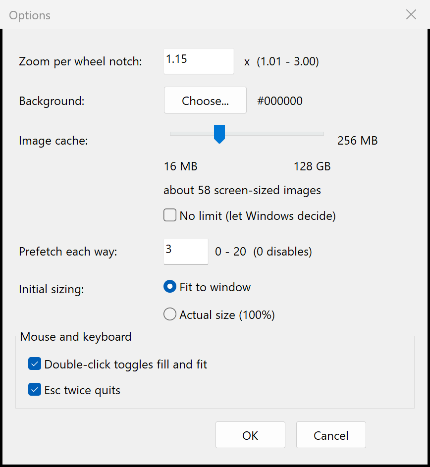

# PlainView



A minimal image viewer for Windows 10 and 11: an ordinary Win32 window, WIC for
decoding, Direct2D for drawing. One portable `PlainView.exe`, no installer, no
bundled runtime, no third-party libraries.

It exists to do one thing quickly: open a picture and put it on screen. No
library, no import step, no thumbnail database, no toolbar. Arrow keys move
through the folder, the wheel zooms around the cursor, and the menu stays out of
the way until you press `Alt`.

## Who it is for

People who keep photos in folders and want to look at them without a photo
manager: double-click a JPEG, see it, press `→`, close it. It suits a clean
Windows install (no Store apps, no MSVC redistributable), a slow machine, or
anyone who wants a viewer that starts in a fraction of a second and leaves
nothing behind but a small `settings.json`.

It is deliberately **not** a cataloguer, an editor, a RAW developer or a cloud
album.

## Download and run

- Take the latest `PlainView-*-win64.zip` from the [releases page](https://github.com/lian9998/PlainView/releases).
- Unpack it anywhere — a folder, a USB stick, `C:\Tools\PlainView`. There is no installer.
- Run `PlainView.exe`.

Requirements: 64-bit Windows 10 (1809 or newer) and Windows 11. The C runtime is
linked statically, so no Visual C++ redistributable is needed. No administrator
rights, and nothing is installed outside `%LOCALAPPDATA%\PlainView\` (and the
per-user registry entries, only if you register it as a viewer).

Release binaries are unsigned. Windows SmartScreen may ask for confirmation the
first time; each release includes a `.sha256` file so you can check what you
downloaded.

## Using it

| Action | How |
| --- | --- |
| Open | `Ctrl+O`, `File → Open…`, drag a file onto the window, or pass a path on the command line |
| Next / previous image | `→` / `←` — natural filename order (`image2` before `image10`), wrapping at the ends |
| Zoom | Mouse wheel, around the cursor; 1.15× per notch by default |
| Pan | Left-button drag |
| Fill ↔ fit | Double-click: cover the window with the image, or show all of it |
| Scroll (fill mode) | Arrow keys move by two-thirds of a view; `←`/`→` at the edge change image, `↑`/`↓` only scroll |
| Quit | `Esc` `Esc` — two presses within 400 ms |
| Menu bar | Hidden by default. `Alt` shows it, `Alt` again hides it |
| Options | `Alt`, then `File → Options…` |

```bat
PlainView.exe                      :: empty black window; open with Ctrl+O or drag & drop
PlainView.exe "D:\photos\a.jpg"    :: open that file immediately
```

In **fill** mode the image covers the window (edges are cropped) and the arrow keys
scroll it by two-thirds of a view. `←` and `→` only leave the current image once the
view is already at that edge, so paging through a folder still works; `↑` and `↓`
never change image. Double-clicking again returns to **fit**, and a wheel zoom leaves
fill mode for free zooming. Both the double-click gesture and double-`Esc` can be
switched off in Options, together with the other optional input behaviours.

## What it does

| Area | Behaviour |
| --- | --- |
| Opening | Command line, `Ctrl+O`, drag & drop |
| Decoding | WIC on a worker thread; the UI thread never touches a file |
| Rendering | Direct2D HWND render target (GPU, with the platform's software fallback) |
| First frame | The decode is requested before the Direct2D device is created, so GPU start-up overlaps it |
| Fit | Fits the window on open, keeps the aspect ratio, re-fits on resize until you zoom |
| Fill | Double-click covers the window; the arrow keys scroll by two-thirds of a view |
| Zoom / pan | Wheel around the cursor; drag to pan; exact 1:1 once zoomed in |
| EXIF | All eight orientation values applied during decode |
| Colour | Embedded ICC profiles applied; an sRGB profile is recognised as the identity and skipped |
| Huge images | Beyond the GPU texture limit: an overview plus on-demand tiles |
| Background | Any opaque colour, chosen with the native Windows colour picker |
| Non-images | The file's Explorer icon, at a tenth of the window width, instead of a blank window |
| Cache | Session-only, screen-resolution, 256 MB budget by default |
| Prefetch | After ~0.7 s idle, up to 3 images each way (configurable 0–20) on two dedicated threads |
| Default viewer | Per-user registration so Windows offers PlainView for image files |
| Footprint | One ~400 KB exe; static C runtime; no external dependencies |

Deliberately absent: thumbnail database, persistent image cache, recents list,
overlays or toolbars, telemetry, auto-update, log files, animation playback.

## Cache and memory

Two rules keep browsing fast without turning the viewer into a memory hog:

- **The current image is full resolution.** That is what makes 1:1 zoom exact
  (a 33 MP photo costs a ~131 MB texture plus its decoded pixels).
- **Everything else is screen resolution.** A neighbour is decoded down to the
  window's longest edge, capped at 4096 px, so a 4K display costs about 33 MB per
  cached image — never the source size.

The cache is RAM-only (nothing is ever written to disk) and bounded:

- Default budget: **256 MB**.
- `Alt → File → Options…` has a logarithmic slider from **16 MB to 128 GB**, or
  **No limit** (`cacheBudgetMB: 0`, which lets Windows decide what to page out).
- Entries are evicted least-recently-used; one entry only has to fit the budget.
- Keys are path + size + last-write time, so an edited file is never served stale.



Returning to a file that is already cached is immediate: the screen-sized copy is
uploaded (a few milliseconds). The full-resolution decode is only requested once
you zoom past what the cached copy can resolve, so arrow-key browsing never pays
for a 131 MB texture.

Prefetching uses two dedicated decode threads, one per direction, so forward and
backward never wait for each other. It starts after ~0.7 s without navigation,
stops at the end of the folder, skips images already cached, and its queues are
dropped when the folder changes. Depth 0 disables it.

## Becoming the default viewer

Windows 11 does not let an application make itself the default silently; the user
picks it in Settings. PlainView can register itself as a proper handler so it
appears in that list:

- **From the app:** `Alt`, then `File → Register as Image Viewer…`, and confirm
  the prompt that opens the Default apps page.
- **From the command line:**

  ```bat
  PlainView.exe --register      :: HKCU only, no administrator rights
  PlainView.exe --unregister    :: removes every entry it created
  ```

Registration writes only under `HKEY_CURRENT_USER`:

```
HKCU\Software\Classes\PlainView.Image\...                 ProgID, icon, open command
HKCU\Software\Classes\Applications\PlainView.exe\...     "Open with" entry + SupportedTypes
HKCU\Software\PlainView\Capabilities\FileAssociations    for Settings → Default apps
HKCU\Software\RegisteredApplications                     PlainView = the above
HKCU\Software\Classes\.jpg\OpenWithProgids               (one per supported extension)
```

Covered extensions: `.jpg .jpeg .jpe .jfif .png .bmp .dib .gif .tif .tiff .ico
.webp .jxr .wdp`. HEIC and AVIF are not claimed: they need codecs from the Store,
and offering PlainView for files it usually cannot open would be misleading.

Then choose it in **Settings → Apps → Default apps → Choose defaults by file type
→ .jpg → PlainView**, or **Set defaults for applications → PlainView**. Explorer's
right-click *Open with* lists it immediately after registering (the app signals
`SHChangeNotify`, so no sign-out is needed).

Browsing to the exe from "Choose another app" is not enough — Windows will not
accept an unregistered executable as a default handler. That is why registration
exists.

## Performance

Median of five cold starts, 1200 × 800 window, images on a local NTFS disk
(`tools/bench.ps1`). "First frame" is measured from process start and includes
window creation and Direct2D device initialisation.

| Measurement | 7008 × 4672 JPEG (33 MP) | 4000 × 2628 JPEG (10.5 MP, sRGB profile) |
| --- | --- | --- |
| First visible image | **711 ms** | **217 ms** |
| WIC decode | 566 ms | 125 ms |
| Texture upload | 61 ms | 12 ms |
| Peak working set | 449 MB | 195 MB |

For comparison, Chromium 1228 (headless, software rasterisation) painted the same
33 MP file at a 656 ms largest-contentful-paint. PlainView's 711 ms includes
process start, so the two are in the same class at 33 MP and the viewer is far
ahead for ordinary photos.

Three decisions came out of measuring rather than guessing:

1. Requesting the decode **before** creating the Direct2D device hides GPU
   start-up behind decoding, which was worth ~400 ms on a cold start.
2. There is no separate preview pass. WIC's scaled JPEG decode costs the same as
   the full decode, so a preview would only delay the full image; the first frame
   is the full-resolution image.
3. WIC's colour transform is expensive even when it cannot change a pixel.
   Recognising the common sRGB profile and skipping the transform halved decode
   time for colour-managed photos (783 ms → 205 ms on the development machine).

Measure on the Windows disk. Reading the same files through a WSL 9P mount
(`\\wsl.localhost\...`) makes decoding several times slower and produced
misleading numbers during development; `tools/bench.ps1` stages inputs locally
for that reason.

## Build from source

Visual Studio 2022 or newer with **Desktop development with C++** and a Windows
10/11 SDK. C++20. No package manager, no third-party code.

```bat
build.bat            :: release, /O2 /MT, output build\PlainView.exe
build.bat debug      :: debug build in build\debug
```

Or with CMake:

```bat
cmake -B build-cmake -S . -G "Visual Studio 18 2026"
cmake --build build-cmake --config Release
```

From WSL, `tools/msvc.sh` runs a Windows command inside the MSVC environment with
the current directory mapped to a temporary drive:

```bash
./tools/msvc.sh -C . 'build.bat'
```

The build is warning-clean at `/W4 /WX /permissive-`.

### Cutting a release

```bat
tools\release.bat
```

builds the portable exe, checks its embedded version against `src/version.h`, and
writes `dist\PlainView-<version>-win64.zip` (exe, `LICENSE`, this README) plus a
`.sha256` file. Bump `src/version.h` to change the version.

### Development commands

```bat
:: render the real pipeline offscreen to a PNG (software Direct2D target)
PlainView.exe --capture out.png image.jpg --size 1600x1000 [--zoom 2.0]

:: measure cold opens: decode, first frame, upload, peak working set
PlainView.exe --bench report.txt image1.jpg image2.png
```

Repeated runs on the local disk:

```powershell
powershell -ExecutionPolicy Bypass -File tools\bench.ps1 -Runs 5 `
    -ImageList "C:\photos\big.jpg;tests\out\demo.jpg"
```

## Settings

`%LOCALAPPDATA%\PlainView\settings.json`, written when you press OK in Options:

```json
{
  "zoomStep": 1.15,
  "cacheBudgetMB": 256,
  "prefetchDepth": 3,
  "backgroundColor": "#000000",
  "initialSizing": "fit",
  "doubleClickFill": true,
  "doubleEscQuits": true
}
```

- `zoomStep` — wheel multiplier, 1.01–3.00.
- `cacheBudgetMB` — session-cache limit in MB; 16–131072, or `0` for no limit.
- `prefetchDepth` — images prefetched in each direction, 0–20; `0` disables it.
- `backgroundColor` — `#RRGGBB`, opaque. An old `#AARRGGBB` value is still read,
  with the alpha byte ignored; backgrounds cannot be see-through.
- `initialSizing` — `fit` or `actual` (100%).
- `doubleClickFill` — double-click toggles fill (cover) and fit (contain).
- `doubleEscQuits` — two `Esc` presses within 400 ms quit.

Missing or malformed members keep their defaults; an unreadable file is ignored.

## Layout

| File | Responsibility |
| --- | --- |
| `src/main.cpp` | entry point, window procedure, menu, bench and capture modes |
| `src/viewer.cpp` | view state (zoom/pan), Direct2D resources, tiled drawing, cache and prefetch scheduling |
| `src/decode.cpp` | WIC session, EXIF orientation, colour management, decode and prefetch threads |
| `src/folder.cpp` | background directory listing, natural sort |
| `src/cache.cpp` | session-only preview cache (LRU, byte budget) |
| `src/settings.cpp` | flat `settings.json` reader/writer |
| `src/options.cpp` | Options dialog |
| `src/register.cpp` | per-user file-handler registration |
| `src/version.h` | version, used by the resource and the release script |
| `src/app.rc` | menu, accelerators, dialog, manifest, version resource |
| `tools/release.ps1` | portable release archive |
| `tools/bench.ps1` | repeated benchmark |
| `docs/measurements.md` | detailed measurements and methodology |

Threading: one decode thread with a latest-wins queue, two prefetch threads (one
per direction), one folder-scan thread, and a generation counter. Every result
carries its generation and is dropped by the UI if a newer file has been
requested; the workers notice the same counter between decode stages and abandon
obsolete work.

## Known limitations

- One image at a time; animated formats show the first frame.
- Decoding uses Windows codecs only. WebP and JPEG XR usually work; HEIC/AVIF
  depend on codecs installed from the Store.
- Downscaling uses Direct2D linear filtering; a mip-mapped pipeline would look
  slightly better at strong reductions.
- Tiles are re-decoded when you pan away and back (there is no persistent cache,
  by design).
- The build is unsigned, so SmartScreen may warn on first launch.

## License

GPL-3.0. See [LICENSE](LICENSE).

The screenshot uses *Utah Dunes Landscape, West Desert District* by the Bureau of
Land Management, public domain, via Wikimedia Commons.
